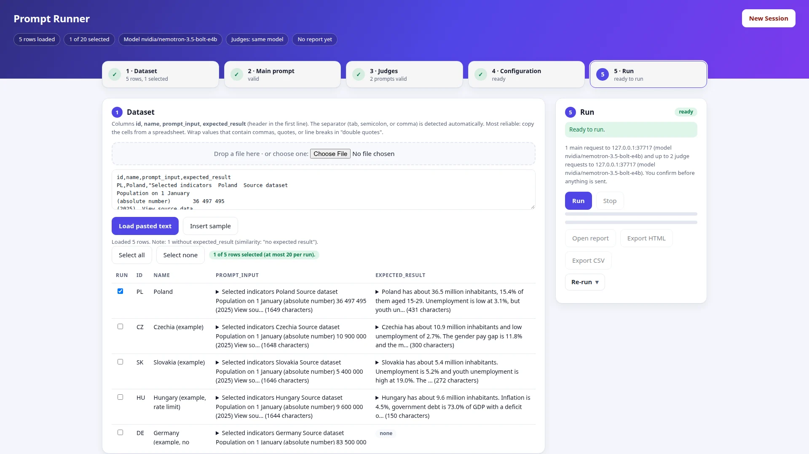
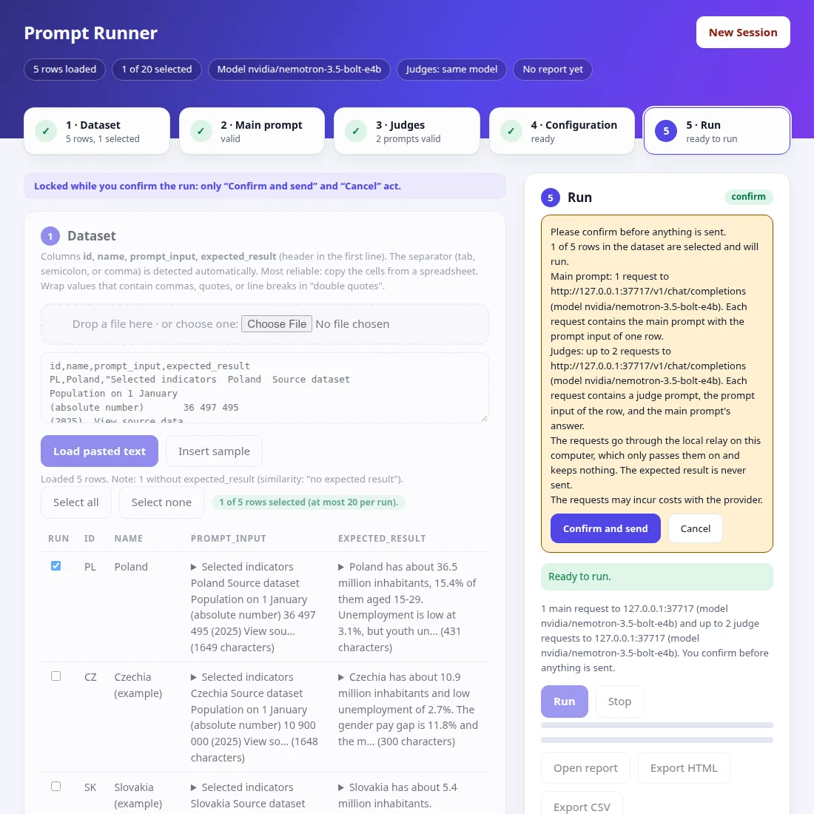
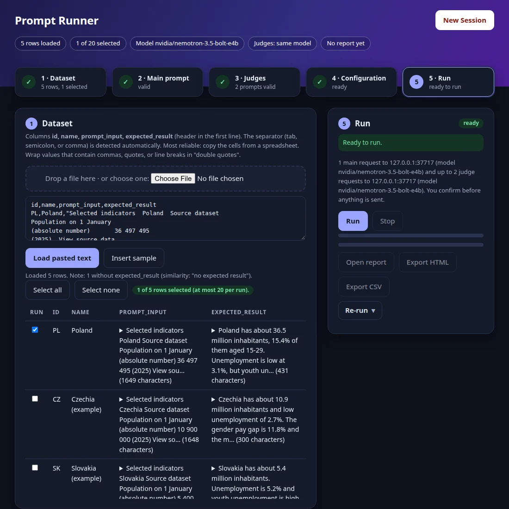
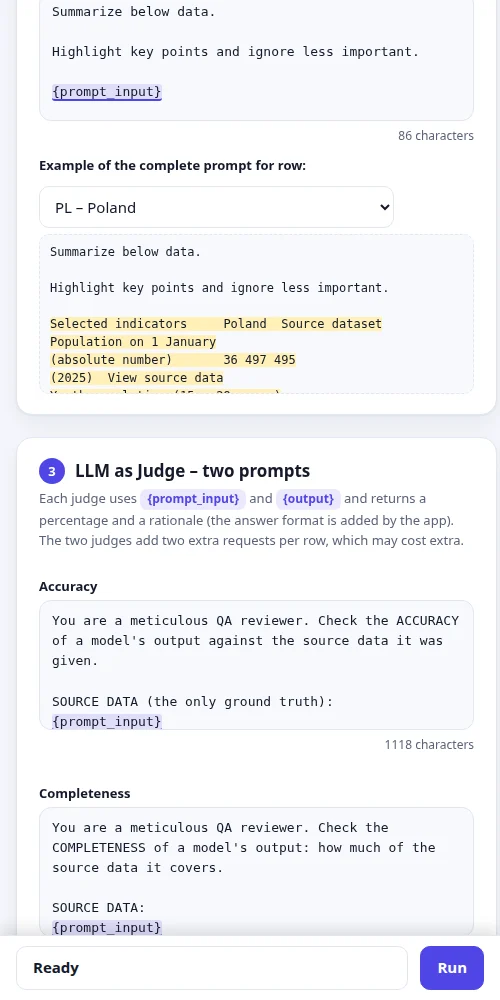
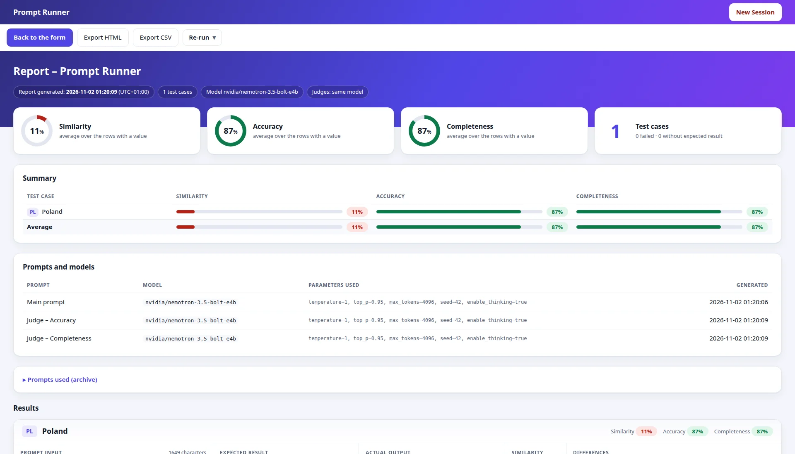
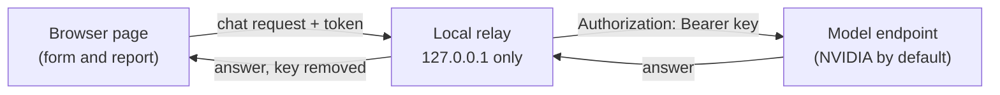

# Prompt Runner

[](https://github.com/wzlinedi/prompt-runner/actions/workflows/test.yml)
[](LICENSE)


**Try one prompt on a dataset, let an LLM judge the answers, and read the report.** A small local tool for one user: no install, no build step, no dependencies, and your API key never leaves your computer's memory.

[Project page](https://wzlinedi.github.io/prompt-runner/) · [Video walk-through](https://wzlinedi.github.io/prompt-runner/#demo) · [Example report](https://wzlinedi.github.io/prompt-runner/demo/report.html) · [Specification](specs/001-simple-prompt-runner/spec.md)



## See it work

A 3.5-minute walk-through (paste data, prompts and judges, endpoint, key and model JSON, confirmation, report, and the Re-run choices) on a fake platform: [watch it on the project page](https://wzlinedi.github.io/prompt-runner/#demo), or download [demo.mp4](docs/assets/demo.mp4). To record it again after a change of the page, run `node tools/record-demo.mjs` (needs Chrome or Chromium and `ffmpeg`).

## Features

- **Dataset in, report out.** Paste text or drop a file (tab, semicolon, or comma separated), run up to 20 rows, and get a report you can export as HTML or CSV.
- **Two ready-made QA judges.** Accuracy and Completeness, each returning a percentage and a rationale. You can edit both prompts.
- **Any chat endpoint.** Defaults to the NVIDIA-hosted models; anything that accepts the same request shape works, and the judges can use a different model.
- **You stay in control.** Nothing is sent until you confirm how many requests go where, and the form is locked while you confirm.
- **Re-run what you need.** All, only the failing main prompts, all judges, or only the failing judges, each with the number of requests shown first.
- **Readable report.** Similarity, word-level differences, grades, and rationales per test case; light and dark; works from 500 to 1920 px.
- **Keyboard only.** The whole flow works without a mouse.
- **Tested end to end.** Unit and contract tests, headless-browser scenarios, a full acceptance walk-through, and an audit that proves a typed key is stored nowhere.

## Quick start

You need [Node.js](https://nodejs.org/) 22 or newer. Nothing else.

```bash
git clone https://github.com/wzlinedi/prompt-runner.git
cd prompt-runner
node app/server.mjs        # or: npm start
```

Open the address it prints (default `http://127.0.0.1:8787`; if the port is taken, a free one is used). Press **New Session**, click **Insert sample** to load five countries, enter your API key, and run.

### Let an AI assistant set it up

Open the cloned folder in an AI coding assistant (for example Claude Code) and paste this prompt:

```text
Set up Prompt Runner and start it for me. Check that Node.js 22+ is installed (offer to install it if not), start the app, open the page, and guide me through the five steps. I will type my API key into the page myself.
```

The assistant reads [AGENTS.md](AGENTS.md), does the setup, and opens the working page. Tests are not needed to use the tool; the assistant runs `npm test` (about 12 seconds) only if something does not start. Your part is to give the data, edit the prompts, and enter the endpoint and the API key in the page. The key is never pasted into the chat.

> **This is a local tool.** It cannot be hosted as a public website: the server must run on your computer (see [How it works](#how-it-works)). The [project page](https://wzlinedi.github.io/prompt-runner/) is only a presentation.

## The five steps

Press **New Session**, then fill the page from top to bottom.

| # | Step | What you do |
|---|------|-------------|
| 1 | **Dataset** | Paste text or choose a file with the columns `id`, `name`, `prompt_input`, `expected_result`. Tick the rows to run: at most 20 per run (the first 20 are selected by default). |
| 2 | **Main prompt** | Edit the text containing `{prompt_input}`. Below it you see the complete prompt for a row of your choice. |
| 3 | **LLM as Judge** | Review two prompts (Accuracy, Completeness) using `{prompt_input}` and `{output}`. The answer format is added by the app and shown in the preview. |
| 4 | **Configuration** | Set the endpoint, the API key, and one JSON with the model and its parameters. The judges use the same model by default; switch that off to give them their own endpoint, key, and JSON. |
| 5 | **Run** | The app tells you how many requests it will send, to which endpoint and model, and which data they contain. Nothing is sent until you confirm. |



While the confirmation is open, steps 1–4 are locked (only **Confirm and send** and **Cancel** act), so what you confirmed is exactly what is sent. A started run keeps its own copy; edits made while it runs apply to the next run. An `http://` endpoint outside your computer gets a warning in the confirmation, because the key and the data would travel unencrypted.

### The page

The page has the look of the report: a **header band** with chips (rows loaded, rows selected out of 20, model, judges, whether a report exists; never a key or an address), a **step indicator** that shows each step as not available, current, done (with a short fact such as "5 rows, 3 selected"), or needing attention, and the **run panel** beside the steps (below them on narrower windows). The panel lists live everything that still blocks a run, grouped by step; an item moves you to its field, and **Run** stays unavailable until the list is empty. Below 1100 px a bar at the bottom of the window shows the state and the one main action (Run, Stop, or Open report). The JSON fields show a badge ("valid · model" or what is wrong), the editors count characters, and a dataset file can be dropped on the dataset card. Motion is subtle (at most 250 ms) and switched off when your system asks for reduced motion.

<p>
  
  
</p>

## The report

When the run ends, the page switches by itself to the **report**, which uses the full width of the window: a header band, cards with the averages, a summary table, the prompts and models used, the collapsed archive of the prompts, and one card per test case. Each card shows the prompt input, the expected result, the actual output, the similarity, and the differences (words only in the expected result struck through, words only in the actual output underlined) side by side, with the grade and the rationale of each judge below. Long texts are shown in full in boxes that scroll inside themselves. The report follows the light or dark setting of your system and stacks on narrow windows.



*The screenshots were taken against a fake local platform, so the model answers in them are placeholders. [Open the example report](https://wzlinedi.github.io/prompt-runner/demo/report.html) to see a complete one.*

**Back to the form** returns to the unchanged steps; step 5 then offers **Open report**, **Export HTML**, **Export CSV**, and **Re-run**.

### Re-running

Running again is one control, **Re-run**, in the run panel and in the toolbar of the report:

| Choice | Sends |
|--------|-------|
| **Re-run all** | Main prompts and judges on the rows of the last run. |
| **Re-run failing main prompts and all related judges** | Only the rows whose main prompt failed, plus their judges. |
| **Re-run all judges** | Every judge request (the one to use after editing a judge prompt). |
| **Re-run only the failing judges** | Exactly the judge requests that failed. If one of ten judge requests fails, one is sent. |

Each choice shows how many requests it would send, and one that cannot be used says why (a run is in progress, nothing failed, no row has an output). A choice made in the report leads back to the form for the key. **New Session** is one button in the header band, also in the report; after a confirmation it removes the report and the session.

### Exports

- **HTML**: the complete report in one file. It cannot load anything when opened from disk.
- **CSV**: one row per test case. A text that begins with `=`, `+`, `-`, `@`, a tab, or a carriage return starts with a single quote (`'`), so a spreadsheet shows it as text instead of evaluating it as a formula; numbers and dates are unchanged.

Results exist only in the open page: **export them before you close or reload it** (the page warns you).

## Configuration

| Setting | Notes |
|---------|-------|
| **Endpoint** | Default `https://integrate.api.nvidia.com/v1/chat/completions`. Any `http` or `https` address that accepts the same chat request shape works. |
| **API key** | Masked on screen, kept in memory only, cleared when a run or any re-run ends, fails, or is stopped. |
| **Model and parameters** | One JSON object with a non-empty `model`, for example `{"model": "nvidia/nemotron-3.5-bolt-e4b", "temperature": 1}`. The keys `messages` and `stream` are set by the app and are refused in this JSON. |
| **Judges** | Same model as the main prompt by default; switch it off to give them their own endpoint, key, and JSON. |

### Dataset format

```text
id,name,prompt_input,expected_result
PL,Poland,"Selected indicators Poland ...","Poland has about 36.5 million inhabitants ..."
```

The separator (tab, semicolon, or comma) is detected automatically. Copying the cells from a spreadsheet is the most reliable way; wrap values that contain commas, quotes, or line breaks in "double quotes". A row without `expected_result` is run, but its similarity shows "no expected result". Details: [dataset format contract](specs/001-simple-prompt-runner/contracts/dataset-format.md).

## How it works



The server serves the page and passes your chat requests on to the endpoint you configure, because the hosted platform does not accept calls straight from a web page. This is why Prompt Runner cannot be a purely static website. The relay listens on the loopback address only, holds nothing between requests, checks the `Host` and `Origin` headers and a per-start random token, does not follow redirects, and removes your key from any answer before passing it on. See the [relay contract](specs/001-simple-prompt-runner/contracts/relay-api.md).

The code is plain ES modules: `app/` holds the server and relay, `app/public/` the page, `tests/` the test suites, and `specs/` the specification that the code is built and checked against.

## Privacy

API keys are kept in memory only, masked on screen, and cleared when a run or any re-run ends, fails, or is stopped. They are never written to a file, browser storage, a log, a URL, or an export. The local server keeps no state, and logs only time, method, path, status, and duration of each request, never keys, prompts, or answers. Its pages carry a strict content-security policy (they load only their own files and cannot be shown inside another site), the exported HTML report cannot load anything when opened from disk, and an answer from the platform larger than 8 MB is refused.

The only places a key may be are the request from the page to the relay and the `Authorization` header to the platform. `npm run audit:key` checks this (see [Tests](#tests)).

## Tests

```bash
npm test                   # unit and contract tests, including the relay tests and a self-test of the live check
npm run test:e2e           # end-to-end scenarios in headless Chrome against a fake platform (Chrome or Chromium required)
npm run accept             # the acceptance walk-through: a real Chrome, real clicks and key presses, real downloads, light and dark, 500–1920 px (about 3 minutes)
npm run audit:key          # the key audit: proves a typed API key is stored nowhere (about 2 minutes)
```

`npm run accept` replaces the hand walk-through of the [quickstart](specs/001-simple-prompt-runner/quickstart.md): it starts the application and the fake platform, goes through every row of the quickstart table, presses Tab through the whole flow, downloads the exports, checks the log for any key, and writes `test-results/acceptance-<date>-<time>/` with `report.html` (verdicts, evidence, a gallery of screenshots next to the reference page), the downloaded files, and `relay.log`. It needs Chrome or Chromium and no key. Exit status 0 means every check passed; 1 a check failed; 2 it could not run. The look of the page, a usability check with a first-time user, and the live check with your own key are not decided by it (the report lists them).

`npm run audit:key` types a fake key and ends a run in seven ways (normal with both exports, the platform repeating the key in an error, Stop, judges re-run, failed-requests re-run, New Session during a run, a key typed and never used), then searches for the key, in several encodings, in the files changed meanwhile, the browser's profile on disk, the application's log, the memory of the page and of the application, the console, the network traffic, history, cookies, storage, the exports, and the page text. It first plants copies of the key in every place to prove that it would see them. It does not look at your terminal, the clipboard, swap files, your everyday browser, or the platform's side. Needs Chrome or Chromium; no real key.

None of these calls the real platform. To check your own key and the platform's behavior once, run the live check, which prints only non-secret facts and never your key:

```bash
read -rs NVIDIA_API_KEY && export NVIDIA_API_KEY && node tests/live/check.mjs
```

The unit and contract tests (`npm test`) run on every push in [GitHub Actions](.github/workflows/test.yml); the browser-based suites need Chrome and are run locally.

## FAQ

**Can I use it online, as a hosted website?**
No. It is a local tool by design: the relay runs on your computer, and your key stays there. The [project page](https://wzlinedi.github.io/prompt-runner/) only presents it.

**Where does my API key go?**
Only to the model endpoint you configured, through the local relay. It is never stored; see [Privacy](#privacy).

**Which models work?**
Any chat endpoint that accepts the same request shape as the NVIDIA-hosted models (`/v1/chat/completions` with a `model` and `messages`). The defaults are the NVIDIA-hosted ones.

**Do the tests cost anything?**
No. They run against a fake platform and need no key.

**My results are gone after a reload.**
By design, nothing is stored in the browser. Export the HTML or CSV before closing the page.

## Specification

This project is built with [Spec Kit](https://github.com/github/spec-kit): the specification comes first, and the code and tests are checked against it.

- [Specification](specs/001-simple-prompt-runner/spec.md): what the tool does and why
- [Plan](specs/001-simple-prompt-runner/plan.md), [research](specs/001-simple-prompt-runner/research.md), and [data model](specs/001-simple-prompt-runner/data-model.md)
- [Contracts](specs/001-simple-prompt-runner/contracts/): relay API, dataset format, export formats, judge answer format, key audit, page UI
- [Tasks](specs/001-simple-prompt-runner/tasks.md) and [quickstart](specs/001-simple-prompt-runner/quickstart.md)

## Contributing

Issues and pull requests are welcome. Run `npm test` before you open a pull request, and keep the rules of the specification (local, single user, no dependencies, keys in memory only). A change that touches behavior starts with the specification.

## License

MIT, see [LICENSE](LICENSE).
